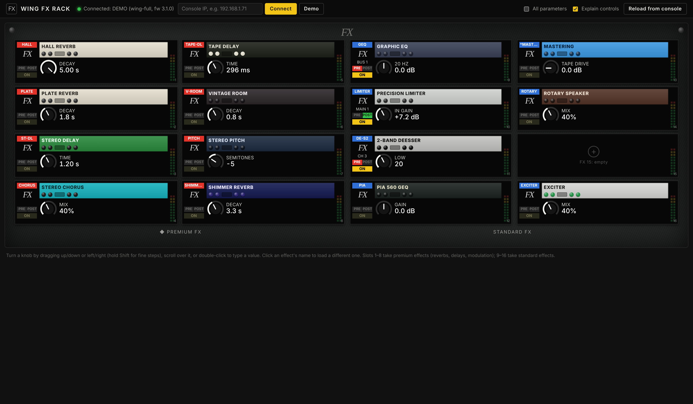
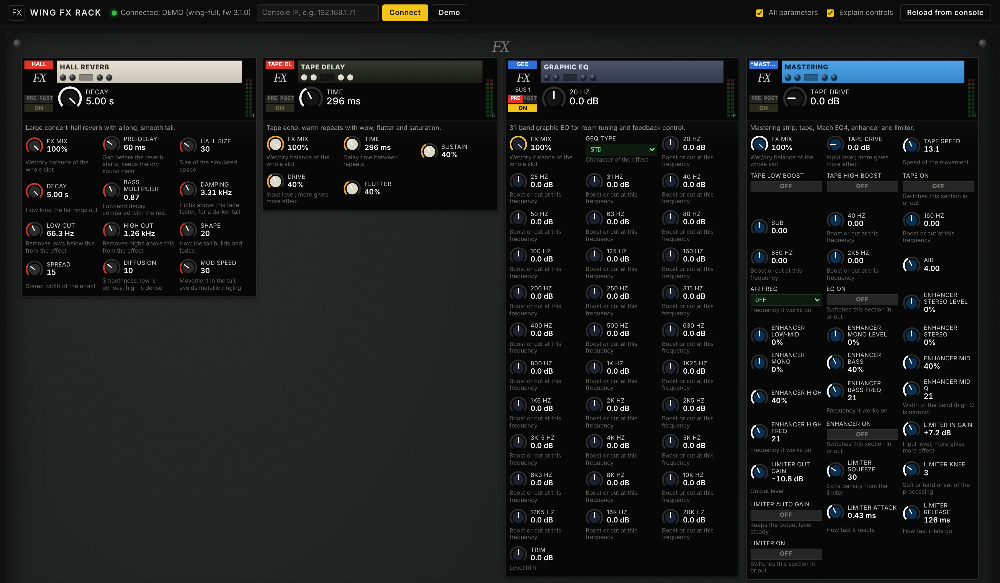

# WING FX Rack

A browser page that shows all 16 FX slots of a Behringer WING in one window, laid out like the console's own EFFECTS screen. Every parameter of every loaded effect is on screen at once, labelled with what it does, and can be changed live.





## Why there is a small bridge

The WING speaks OSC over UDP, and web browsers can't send UDP. So a tiny Node.js program (`bridge.js`) runs on a computer on the same network as the console. It serves the page and passes messages between the page and the WING. It has no dependencies: no `npm install` needed.

```
browser  ⇄  WebSocket  ⇄  bridge.js  ⇄  OSC/UDP 2223  ⇄  WING
```

Any number of browsers (laptop, iPad, phone) can open the page at once; they all stay in sync.

## Run it

Needs [Node.js](https://nodejs.org) 18 or newer.

```sh
cd fx-rack
node bridge.js 192.168.1.71     # your WING's IP (Setup › Network on the console)
```

Then open <http://localhost:8080>. The bridge also prints an address you can open from a tablet on the same network.

- `node bridge.js` alone starts without a console; type the IP in the page and press Connect. The page remembers it.
- `node bridge.js --demo` (or the Demo button) uses a pretend console, to try it out without a WING.
- `--port 9000` changes the web port.

## Using it

- Same order as the console: FX 1–4 down the first column, 5–8 the second (premium half), 9–16 on the right (standard half).
- Each tile shows, like the console: the model tag (red = premium slot, blue = standard), where it's inserted (e.g. BUS 1), PRE/POST, ON when inserted, a faceplate in the effect's colours, and a big knob for its main parameter. The meter is decoration only: levels aren't available over OSC.
- Click the effect's name on the faceplate (or the + on an empty slot) to load a different effect. Slots 1–8 offer premium effects; 9–16 offer standard ones.
- Below each tile: a one-line description and every parameter as a knob, switch or list.
- **Knobs**: drag up/down or left/right (the value moves relative to your finger, it never jumps), hold Shift for fine steps, scroll the mouse wheel, use the arrow keys, or double-click to type an exact value (`2.5k` works for Hz).
- **All parameters** (top right) off gives just the console-style 4 × 4 overview.
- **On/Off** buttons and **drop-downs** for switch and list parameters.
- **Explain controls** (top right) shows a one-line explanation under every control; turn it off for a more compact view.
- **Reload from console** reads every slot again.

## How it reads the console

From Patrick-Gilles Maillot's *WING Remote Protocols* (FW 3.1):

| What | OSC |
|---|---|
| Loaded effect | `/fx/N/mdl` (text, e.g. `HALL`; send text to load another) |
| Slot mix | `/fx/N/fxmix` (0…100 %) |
| Insert assignment | `/fx/N/$a_chn`, `/fx/N/$a_pos` (read only) |
| Parameter names of the loaded effect | send the bare node `/fx/N`; the reply lists them |
| A parameter | `/fx/N/<name>`, reply `,sff` = text, normalized, real value |
| Live updates | `/*S`, renewed every 8 s |

Parameter labels, ranges and step counts come from the same document's appendix, stored in `public/catalog.js`. The console's own parameter list decides which controls appear; a parameter that isn't in the catalog is shown read-only.

## Not yet checked on a real console

This was built and tested against the demo console only. Things to watch when you first connect to the WING:

- Whether the parameter values arrive and move when you turn things on the console.
- The insert label: the mapping of `$a_chn` numbers to Ch/Aux/Bus/Main/Mtx is a guess (1–40 channels, 41–48 aux, 49–64 buses, 65–68 mains, 69–76 matrix).
- A few catalog ranges had typos in the source document and were fixed by hand (Hall bass multiplier max, P-Bass crossover, Velvet Imager width, Mood LFO, Even/Soul/Bus strip mix).

## Files

- `bridge.js`: web server + WebSocket + start-up options.
- `wing.js`: OSC conversation with the WING and the mirror of the 16 slots.
- `demo-wing.js`: pretend console used by `--demo` and the tests.
- `osc.js`, `ws.js`: minimal OSC and WebSocket code.
- `public/`: the page (`app.js`, `style.css`), effect catalog (`catalog.js`), plain-language text (`help.js`) and faceplate colours (`look.js`). The faceplates are drawn in CSS from each unit's colours; no Behringer artwork is included.
- `test/`: `npm test` (or `node --test test/*.test.js`).
